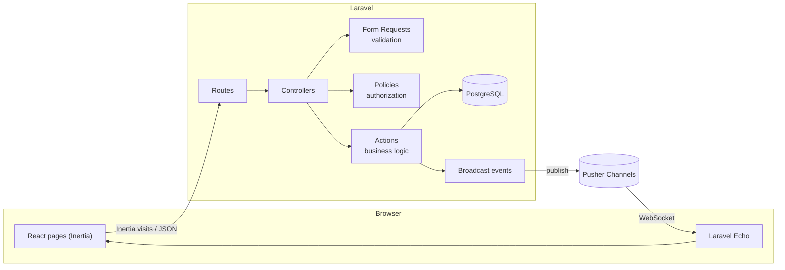

<div align="center">

# TaskFlow

**Real-time Kanban project manager with teams and role-based permissions.**

[](https://github.com/dailaaaaan/taskflow/actions/workflows/ci.yml)
[](LICENSE)


</div>

> 🚧 **Work in progress.** Track progress in the [roadmap](#roadmap) and the [changelog](CHANGELOG.md).

## Overview

TaskFlow lets teams organise work on Kanban boards and see each other's changes as they happen. It is a full-stack portfolio project focused on what production applications need: authentication, relational data modelling, authorization, real-time updates and an automated quality pipeline.

## Roadmap

- [x] Project foundation: CI pipeline, static analysis, architecture tests, Git hooks
- [x] Authentication: registration, login, password reset, 2FA and passkeys
- [ ] PostgreSQL schema: teams, memberships, boards, lists, cards
- [ ] Teams with **admin / member** roles and invite links
- [ ] Boards, lists and cards (CRUD)
- [ ] Drag & drop with optimistic updates
- [ ] Real-time collaboration and presence ("who is viewing")
- [ ] Responsive, accessible UI with dark mode
- [ ] Production deployment with a demo account

## Tech stack

| Area     | Technology                                                             |
| -------- | ---------------------------------------------------------------------- |
| Backend  | PHP 8.5, Laravel 13, Laravel Fortify                                   |
| Frontend | React 19, TypeScript (strict), Inertia.js 3, Tailwind CSS 4, shadcn/ui |
| Database | PostgreSQL 17                                                          |
| Realtime | Laravel broadcasting, Pusher Channels, Laravel Echo                    |
| Testing  | Pest 5 (unit, feature, architecture, browser), Vitest, Playwright      |
| Quality  | Larastan (level 8), Pint, Vite+ (Oxlint, Oxfmt), commitlint, Husky     |
| CI/CD    | GitHub Actions, Dependabot                                             |

## Architecture

TaskFlow is a **Laravel monolith that uses Inertia to render React pages**. There is no separate API to maintain: one codebase, session authentication and a single deployment ([ADR-0001](docs/adr/0001-laravel-inertia-monolith.md)).



Every request goes through the same layers: **validate** (Form Request), **authorize** (Policy), **execute** (Action) and **notify** (Event). Architecture tests enforce this layering, so it cannot erode over time. See [`CLAUDE.md` §5](CLAUDE.md#5-architecture-rules) and the [architecture decision records](docs/adr/).

## Getting started

### Prerequisites

- PHP 8.3+ and Composer 2 ([Laravel Herd](https://herd.laravel.com) is the easiest option on Windows and macOS)
- Node.js 22+
- Docker (for PostgreSQL, from Phase 2)

### Installation

```bash
git clone https://github.com/dailaaaaan/taskflow.git
cd taskflow
composer setup     # PHP + JS dependencies, .env, app key, migrations, asset build
npm run prepare    # install Git hooks (npm lifecycle scripts are disabled by .npmrc)
composer run dev   # http://localhost:8000
```

## Quality and testing

| Gate                     | Tool                  | Command                |
| ------------------------ | --------------------- | ---------------------- |
| PHP code style           | Pint                  | `composer lint:check`  |
| PHP static analysis      | Larastan, level 8     | `composer types:check` |
| Frontend lint and format | Vite+ (Oxlint, Oxfmt) | `npm run check`        |
| Type checking            | TypeScript (strict)   | `npm run types:check`  |
| Tests                    | Pest                  | `php artisan test`     |
| **Everything above**     |                       | `composer ci:check`    |

The CI pipeline runs on every push and pull request:

- **Quality**: style, static analysis, lint, type checking and a dependency audit (`composer audit`, `npm audit`)
- **Tests**: the full Pest suite with PCOV coverage, a JUnit report published as a check run, and reports uploaded as artifacts
- **Conventional commits**: every commit message in the pull request is validated

The test strategy and the test inventory are documented in [`docs/TESTING.md`](docs/TESTING.md).

## Project documentation

| Document                             | Purpose                                                      |
| ------------------------------------ | ------------------------------------------------------------ |
| [`CLAUDE.md`](CLAUDE.md)             | Engineering conventions and AI collaboration contract        |
| [`CONTRIBUTING.md`](CONTRIBUTING.md) | Branching, commits, pull requests and the Definition of Done |
| [`docs/adr/`](docs/adr/)             | Architecture decision records                                |
| [`docs/TESTING.md`](docs/TESTING.md) | Test strategy and inventory                                  |
| [`SECURITY.md`](SECURITY.md)         | Vulnerability reporting and security measures                |
| [`CHANGELOG.md`](CHANGELOG.md)       | Notable changes per release                                  |

## AI-assisted development

This project is developed with **Claude Code** as a pair programmer. The working agreement is public in [`CLAUDE.md`](CLAUDE.md): the AI writes code inside strict quality gates, while the author owns every decision, reviews every change and performs all version-control operations.

## License

Released under the [MIT License](LICENSE).
