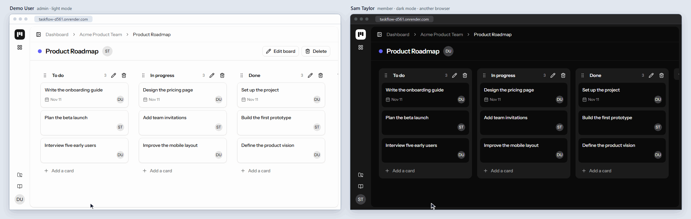
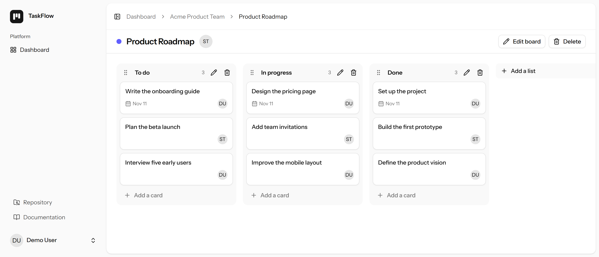
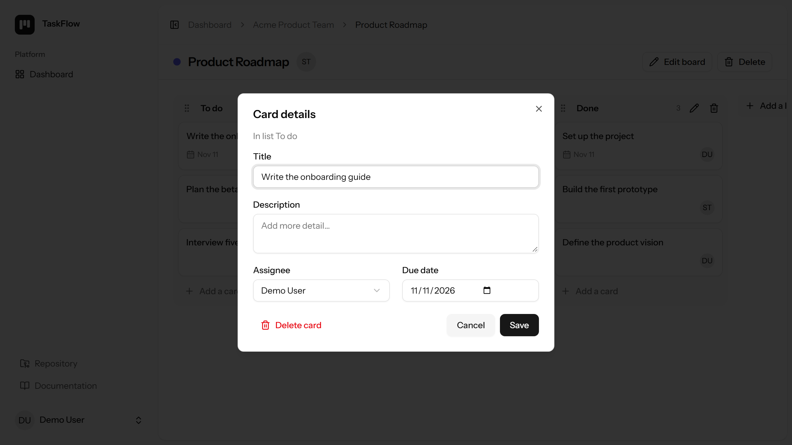
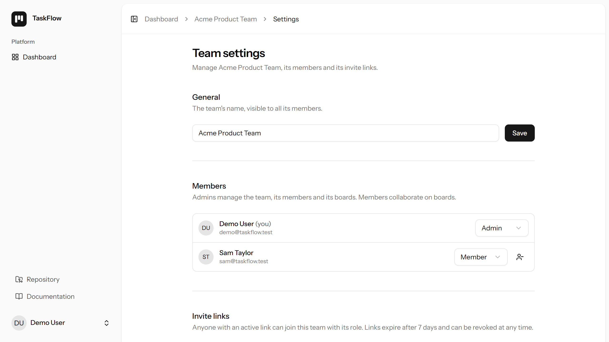
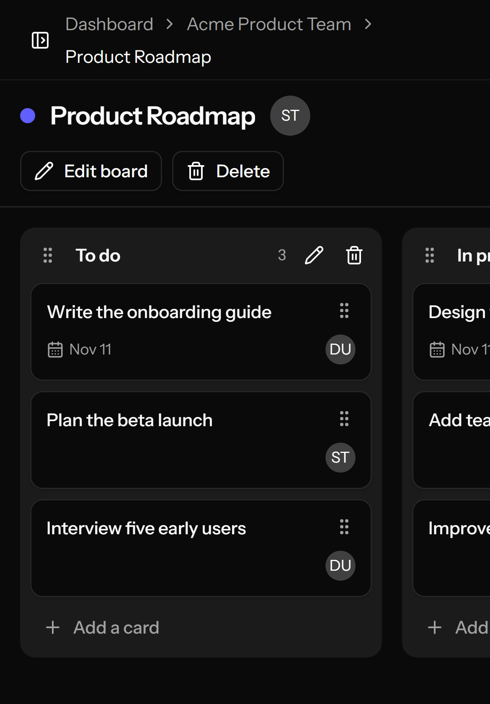
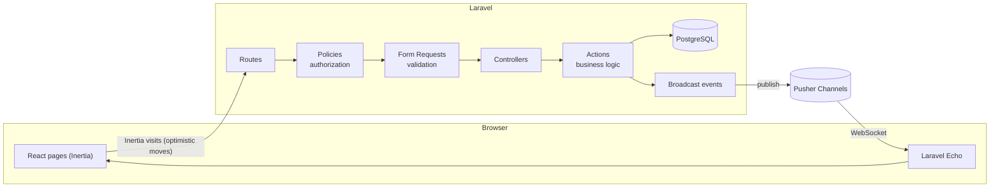

<div align="center">

# TaskFlow

**Real-time Kanban project manager with teams and role-based permissions.**

[](https://github.com/dailaaaaan/taskflow/actions/workflows/ci.yml)
[](LICENSE)


**[Try the live demo](https://taskflow-d561.onrender.com)**: one click, no sign-up.



</div>

## Overview

TaskFlow lets teams organise work on Kanban boards and see each other's changes as they happen. It is a full-stack portfolio project focused on what production applications need: authentication, relational data modelling, authorization, real-time updates and an automated quality pipeline.

## Live demo

<https://taskflow-d561.onrender.com>

1. Click **Try the live demo** to open a shared board.
2. To see real-time collaboration, open the same address in a private window, click **join as Sam** and move a card in either window.

The demo runs on free plans: after 15 idle minutes, the next visit takes about a minute to wake the server. Every start puts the demo workspace back to its original state.

## Screenshots

<picture>
    <source media="(prefers-color-scheme: dark)" srcset="docs/images/board-dark.png">
    
</picture>

|                                                         Card details                                                          |                                                  Roles and invite links                                                  |                                          On a phone                                          |
| :---------------------------------------------------------------------------------------------------------------------------: | :----------------------------------------------------------------------------------------------------------------------: | :------------------------------------------------------------------------------------------: |
|  |  |  |

## Features

- **Teams with roles.** Admins manage the team, its members and its boards. Members work on the boards. Invite links are signed, expire after 7 days and can be revoked.
- **Boards, lists and cards**, with descriptions, assignees and due dates.
- **Drag & drop** of cards and lists with a mouse, a finger or the keyboard. A move shows at once and is undone if the server refuses it.
- **Live collaboration.** Changes reach everyone on the board in under a second, and avatars show who else is viewing it.
- **Accounts** with email verification, password reset, two-factor authentication, passkeys and optional GitHub login.
- **Accessible and responsive**, in light and dark mode. Drag & drop is announced to screen readers, and every page is audited with axe in both colour schemes.

## Tech stack

| Area     | Technology                                                                      |
| -------- | ------------------------------------------------------------------------------- |
| Backend  | PHP 8.5, Laravel 13, Laravel Fortify, Laravel Socialite (GitHub OAuth)          |
| Frontend | React 19, TypeScript (strict), Inertia.js 3, Tailwind CSS 4, shadcn/ui, dnd-kit |
| Database | PostgreSQL 17                                                                   |
| Realtime | Laravel broadcasting, Pusher Channels, Laravel Echo                             |
| Testing  | Pest 5 (unit, feature, architecture, browser), Vitest, Playwright               |
| Quality  | Larastan (level 8), Pint, Vite+ (Oxlint, Oxfmt), commitlint, Husky              |
| CI/CD    | GitHub Actions, Dependabot                                                      |
| Hosting  | Docker image with FrankenPHP on Render, PostgreSQL on Neon                      |

## Architecture

TaskFlow is a **Laravel monolith that uses Inertia to render React pages**. There is no separate API to maintain: one codebase, session authentication and a single deployment ([ADR-0001](docs/adr/0001-laravel-inertia-monolith.md)).



Every request goes through the same layers: **authorize** (Policy, declared on the route), **validate** (Form Request), **execute** (Action) and **notify** (Event). Authorization comes first, so someone without access gets a `403` and never learns which fields were wrong. Architecture tests enforce this layering, so it cannot erode over time. See [`CLAUDE.md` §5](CLAUDE.md#5-architecture-rules).

### Design decisions

Each one is recorded with its context and trade-offs in an [architecture decision record](docs/adr/).

- **Authorization through the board.** Lists and cards have no policy of their own: their routes are nested under the board, so one check covers them, and an id from another board is a `404` ([ADR-0007](docs/adr/0007-authorize-lists-and-cards-through-the-board.md)).
- **Integer positions with gaps.** Moving a card usually writes a single row. Positions are spread out again inside a transaction only when a gap runs out ([ADR-0003](docs/adr/0003-integer-gap-positions.md)).
- **One reducer for every change.** The same pure function applies a user's own optimistic moves and the events of other users, so both paths behave the same and are unit tested once ([ADR-0008](docs/adr/0008-drag-and-drop-with-optimistic-inertia-visits.md), [ADR-0009](docs/adr/0009-realtime-board-events.md)).
- **Failures that fit the request.** A failed visit shows an error page that works even with the database down, and a failed write stays on its page with a toast ([ADR-0010](docs/adr/0010-error-pages-and-failure-toasts.md)).
- **Free hosting, tested like production.** CI builds the production image, starts it with the memory of the free plan and opens the demo from outside ([ADR-0011](docs/adr/0011-free-production-hosting.md)).

## Getting started

### Prerequisites

- PHP 8.3+ and Composer 2 ([Laravel Herd](https://herd.laravel.com) is the easiest option on Windows and macOS)
- Node.js 24, the version that CI and the production image use
- Docker (runs PostgreSQL 17)

### Installation

```bash
git clone https://github.com/dailaaaaan/taskflow.git
cd taskflow
cp .env.example .env              # set DB_PORT if 5432 is already taken
docker compose up -d --wait       # PostgreSQL with the app and test databases
composer setup                    # PHP + JS dependencies, app key, migrations, asset build
php artisan db:seed               # demo workspace (login: demo@taskflow.test / password)
npm run prepare                   # Git hooks (npm lifecycle scripts are disabled by .npmrc)
npx playwright install chromium   # browser for the browser test suite
composer run dev                  # http://localhost:8000
```

### Optional: GitHub login

1. Create an OAuth App at <https://github.com/settings/developers> with the callback URL `http://localhost:8000/auth/github/callback`.
2. Set `GITHUB_CLIENT_ID` and `GITHUB_CLIENT_SECRET` in `.env`.

While `GITHUB_CLIENT_ID` is empty, the "Continue with GitHub" button is hidden and its routes return `404`. See [ADR-0005](docs/adr/0005-github-login-account-linking.md) for how accounts are linked.

### Optional: live updates

1. Create a Channels app at <https://dashboard.pusher.com> (the free plan is enough).
2. Set `BROADCAST_CONNECTION=pusher` and the `PUSHER_APP_ID`, `PUSHER_APP_KEY`, `PUSHER_APP_SECRET` and `PUSHER_APP_CLUSTER` values in `.env`.

Without them everything works, except that other people's changes only appear after a reload. See [ADR-0009](docs/adr/0009-realtime-board-events.md).

## Deployment

TaskFlow runs for free on Render, Neon and Pusher, all in the EU, from a [production image](Dockerfile) that CI builds and tests on every pull request. Render deploys `main` once CI passes. Step-by-step instructions and fixes for common failures are in [`docs/DEPLOYMENT.md`](docs/DEPLOYMENT.md), and the reasons in [ADR-0011](docs/adr/0011-free-production-hosting.md).

## Quality and testing

| Gate                          | Tool                      | Command                               |
| ----------------------------- | ------------------------- | ------------------------------------- |
| PHP code style                | Pint                      | `composer lint:check`                 |
| PHP static analysis           | Larastan, level 8         | `composer types:check`                |
| Frontend lint and format      | Vite+ (Oxlint, Oxfmt)     | `npm run check`                       |
| Type checking                 | TypeScript (strict)       | `npm run types:check`                 |
| Tests                         | Pest                      | `php artisan test`                    |
| Frontend unit tests           | Vitest (via Vite+)        | `npm test`                            |
| Browser tests (Chromium, axe) | Pest Browser + Playwright | `vendor/bin/pest --testsuite=Browser` |
| E2E (live updates, touch)     | Playwright + local Reverb | `npm run e2e`                         |
| **Everything but the E2E**    |                           | `composer ci:check`                   |

The CI pipeline runs on every push and pull request:

- **Quality**: style, static analysis, lint, type checking, frontend unit tests (Vitest) and a dependency audit (`composer audit`, `npm audit`)
- **Tests**: the full Pest suite on PostgreSQL, including browser tests in headless Chromium, with PCOV coverage, a JUnit report published as a check run, and reports uploaded as artifacts
- **Realtime E2E**: two browsers on the same board, a dropped connection, a real touch drag and held requests, against a local Reverb server
- **Docker image**: builds the production image, starts it with the memory of the free plan and opens the demo from outside
- **Conventional commits**: every commit message in the pull request is validated

The test strategy and the test inventory are documented in [`docs/TESTING.md`](docs/TESTING.md).

## Project documentation

| Document                                   | Purpose                                                      |
| ------------------------------------------ | ------------------------------------------------------------ |
| [`CLAUDE.md`](CLAUDE.md)                   | Engineering conventions and AI collaboration contract        |
| [`CONTRIBUTING.md`](CONTRIBUTING.md)       | Branching, commits, pull requests and the Definition of Done |
| [`docs/adr/`](docs/adr/)                   | Architecture decision records                                |
| [`docs/TESTING.md`](docs/TESTING.md)       | Test strategy and inventory                                  |
| [`docs/DEPLOYMENT.md`](docs/DEPLOYMENT.md) | Production deployment, step by step                          |
| [`SECURITY.md`](SECURITY.md)               | Vulnerability reporting and security measures                |
| [`CHANGELOG.md`](CHANGELOG.md)             | Notable changes per release                                  |

## AI-assisted development

This project is developed with **Claude Code** as a pair programmer. The working agreement is public in [`CLAUDE.md`](CLAUDE.md): the AI writes code inside strict quality gates, while the author owns every decision, reviews every change and performs all version-control operations.

## License

Released under the [MIT License](LICENSE).
